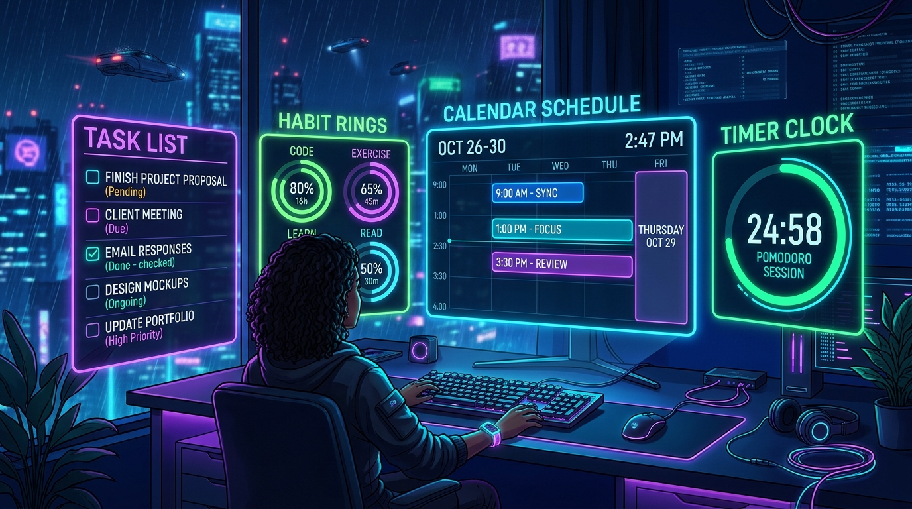

# FocusLife – Plan • Do • Grow

**FocusLife** is a complete, modern, professional productivity and life management application built with Kotlin, Jetpack Compose, Material Design 3, Room Database, and Gemini AI.



## 🌟 Highlights & Core Features

- **📱 User Onboarding Flow**: 5-slide interactive walkthrough introducing Task Management, Habit Streaks, Pomodoro Focus, Calendar & Notes, and AI Coach. Fully bilingual with skip option and guest mode.
- **🎨 Premium Dark Interface**: Deep navy/charcoal backgrounds with vibrant electric purple, cyber blue, and neon green accents. M3 elevation, smooth animations, and light/dark theme support.
- **🎯 Task Management**: Full CRUD, priorities (High, Medium, Low), categories (Work, Study, Personal, Health), due dates & times, search, filter tabs (All, Today, Completed), and celebratory completion feedback.
- **🌱 Habit Tracker**: Daily habit formation, streak flames, weekly consistency bubbles (M-T-W-T-F-S-S), progress tracking, and best streak records.
- **⏱️ Pomodoro Focus Timer**: Working 25m Focus, 5m Short Break, 15m Long Break sessions with circular animated countdown ring, session counter, focus statistics logging, and completion alerts.
- **📅 Smart Calendar**: Interactive monthly calendar grid, schedule timeline, and event management with location and reminder tags.
- **📝 Notes System**: Pinning, instant search, tag organization, and custom color labels.
- **🤖 AI Productivity Coach**: Natural language assistant supporting Bengali (বাংলা) and English. Provides daily planning, goal breakdown, habit coaching, and productivity suggestions. Powered by Firebase AI Logic / Gemini with intelligent local fallback.
- **🔔 Native Android Notifications**: Proper `NotificationManager` channels (`Tasks`, `Habits`, `Pomodoro`, `Daily Planning`), lock screen visibility, runtime permissions (Android 13+ `POST_NOTIFICATIONS`), and quick-action notification buttons.
- **📊 Analytics & Statistics**: Daily momentum score, weekly task bar charts, habit consistency rate, and unlockable achievement milestones.
- **🌐 Bilingual Localization**: Instant 1-tap switching between English and Bengali (বাংলা) across every screen, dialog, and prompt.
- **💾 Offline-First Architecture**: Powered by native Android Room Database. Guest mode allows complete offline usage without requiring an account. JSON data backup and export.
- **📲 Home Screen Widget**: Quick glance widget displaying today's tasks, pending habits, active streak, and quick-launch shortcut.

---

## 🛠️ Tech Stack & Architecture

- **Language**: Kotlin 2.x
- **UI Toolkit**: Jetpack Compose with Material Design 3 (M3)
- **Architecture**: MVVM (Model-View-ViewModel) + Repository Pattern + Clean Data Layer
- **Persistence**: Android Jetpack Room Database (with KSP)
- **AI Engine**: Firebase AI Logic (Gemini 3.8 Flash) with resilient offline contextual coach
- **Notifications**: Android `NotificationManager`, `NotificationChannel`, `AlarmManager`
- **Asynchrony**: Kotlin Coroutines & Reactive `StateFlow`
- **Build System**: Gradle Kotlin DSL (`.gradle.kts`) with Version Catalog (`libs.versions.toml`)

---

## 🚀 Building & Running the Project

### Prerequisites
- Android Studio Ladybug (or newer)
- JDK 17+
- Android SDK 36 (Min SDK 24)

### Build Commands
To assemble a debug APK:
```bash
./gradlew assembleDebug
```
The output APK will be located at:
`app/build/outputs/apk/debug/app-debug.apk`

To run local unit tests:
```bash
./gradlew testDebugUnitTest
```

---

## 🔒 Privacy & Permissions
- `android.permission.INTERNET` & `ACCESS_NETWORK_STATE`: For optional Gemini AI features and synchronization.
- `android.permission.POST_NOTIFICATIONS`: For native Android 13+ lock screen and banner reminders.
- `android.permission.VIBRATE`: For Pomodoro session completion haptics.
- `android.permission.RECEIVE_BOOT_COMPLETED`: For rescheduling priority reminders after device reboot.

*All core productivity features (tasks, habits, notes, calendar, timer) function 100% offline with zero data leakage.*
